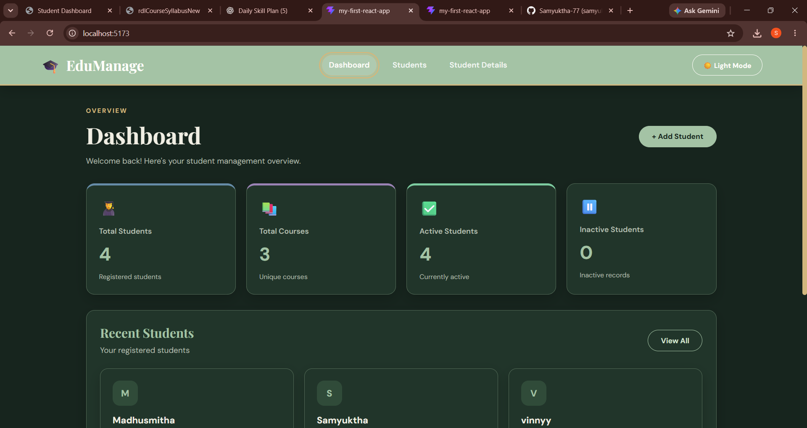

# 🎓 EduManage – Student Management System

A responsive Student Management System built using React. EduManage helps manage student records through a clean dashboard and simple interface.

## 📸 Project Preview



## ✨ Features

- 📊 Dashboard with student statistics
- ➕ Add new student records
- ✏️ Edit existing student details
- 🗑️ Delete student records
- 🔍 Search students
- 🎯 Filter students
- 🌙 Dark Mode and Light Mode
- 💾 Local Storage for data persistence
- 📱 Responsive mobile-friendly design

## 🛠️ Technologies Used

- React.js
- JavaScript
- HTML5
- CSS3
- React Router
- Vite
- Browser Local Storage

## 🚀 Getting Started

Clone the repository:

```bash
git clone YOUR_GITHUB_REPOSITORY_URL
```

Navigate into the project:

```bash
cd my-first-react-app
```

Install dependencies:

```bash
npm install
```

Start the development server:

```bash
npm run dev
```

## 🎯 Learning Outcomes

- React components and props
- React Hooks and Context API
- State management
- CRUD operations
- React Router
- Responsive CSS design
- Local Storage

## 👩‍💻 Author

**Samyuktha Padma**

GitHub: [Samyuktha-77]https://github.com/Samyuktha-77
